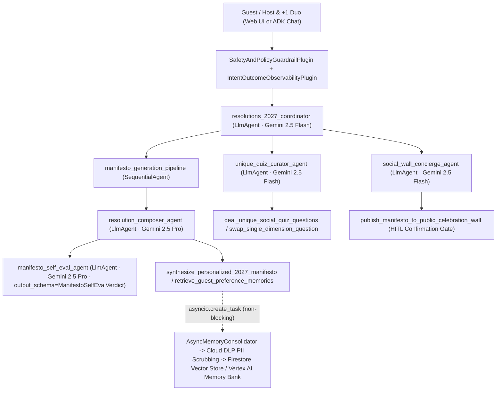

# 2027 Resolutions Atelier Agent (Google ADK)

An interactive, production-grade AI Concierge Agent built with the **Google Agent Development Kit (`google-adk`)** and **Gemini 2.5 Flash / Pro** on **Google Cloud** for December year-end social celebrations.

---

## Problem & Solution

- **The Problem**: At year-end holiday gatherings, generic New Year's resolution conversations feel repetitive, dry, or intimidating—especially when welcoming both team members and their `+1` guests.
- **The Solution**: The **2027 Resolutions Atelier Agent** deals **5 unique, non-repeating fun questions** per guest (across 5 playful dimensions so no two guests in line get the same quiz!), blends conversational memory with custom write-in twists, and orchestrates specialized Gemini Flash & Pro sub-agents to craft a hilarious, deeply personalized **2027 Resolution Manifesto**, **Official Anti-Resolution**, and **Celebration Toast**—complete with a **Human-in-the-Loop (HITL) approval gate** before sharing to the live Celebration Wall.

---

## Multi-Agent Architecture



---

## AgentOps 95-Point Code Review Matrix Evidence

| # | Category | Criteria | Implementation Evidence | Points |
| :- | :--- | :--- | :--- | :-: |
| 1 | **1. Tool & Interface Design** | **Comprehensive Tool Docstrings** | Every tool in `resolutions_agent/tools.py` includes detailed purpose, `Args:`, and `Returns:` docstrings. | 5 |
| 2 | | **Descriptive Naming** | Specific verb-noun names: `deal_unique_social_quiz_questions`, `swap_single_dimension_question`, `retrieve_guest_preference_memories`, `synthesize_personalized_2027_manifesto`, `publish_manifesto_to_public_celebration_wall`, `fetch_live_celebration_wall_highlights`. | 5 |
| 3 | | **Explicit JSON Schemas** | Strict Pydantic v2 `ConfigDict(extra="forbid")` input/output schemas in `resolutions_agent/schemas.py` + `output_schema=ManifestoSelfEvalVerdict`. | 5 |
| 4 | | **Guided Error Handling** | Tools return structured `GuidedToolErrorResponse` with `llm_recovery_instructions` + `ReflectAndRetryToolPlugin(max_retries=2)` in `resolutions_agent/agent.py`. | 5 |
| 5 | **2. Context & Memory** | **Robust System Instructions** | Explicit constitutions in `resolutions_agent/prompts.py` defining persona, anti-repetition rules, safety, and HITL mandates. | 5 |
| 6 | | **History Compaction** | ADK `EventsCompactionConfig(compaction_interval=4, overlap_size=1, token_threshold=12000, event_retention_size=4)`, `ContextCacheConfig`, `ContextFilterPlugin`, and `SlidingWindowHistoryCompactor` (`resolutions_agent/memory_store.py`). | 5 |
| 7 | | **Persistent Session State** | `DatabaseSessionService` / `VertexAiSessionService`, `VertexAiMemoryBankService`, Cloud Firestore Vector Store, and Vertex AI Search (`discoveryengine_v1`) in `resolutions_agent/memory_store.py`. | 5 |
| 8 | | **Async Memory Operations** | `AsyncMemoryConsolidator.schedule_consolidation` (`asyncio.create_task` background embedding & persistence) in `resolutions_agent/memory_store.py`. | 5 |
| 9 | **3. Orchestration & Logic** | **Multi-Agent Patterns** | Coordinator `LlmAgent` + `SequentialAgent` (`manifesto_generation_pipeline` chaining Composer → Self-Evaluator) + specialized sub-agents in `resolutions_agent/agent.py`. | 5 |
| 10 | | **Strategic Model Routing** | `StrategicModelRouter` (`resolutions_agent/guardrails.py`) routes fast curation/wall tasks to `gemini-2.5-flash` and complex manifesto synthesis & self-critique to `gemini-2.5-pro`. | 5 |
| 11 | | **Guardrails & Policy Plugins** | `SafetyAndPolicyGuardrailPlugin(BasePlugin)` (`resolutions_agent/guardrails.py`) + structured `manifesto_self_eval_agent` self-evaluation loop. | 5 |
| 12 | | **Human-in-the-Loop Hooks** | `FunctionTool(..., require_confirmation=...)` + HMAC-verified `before_tool_callback` code stop in `publish_manifesto_to_public_celebration_wall` (`resolutions_agent/tools.py`, `resolutions_agent/guardrails.py`). | 5 |
| 13 | **4. Observability & Tracing** | **Structured JSON Logging** | `RedactingJsonFormatter` (`python-json-logger`) + `google-cloud-logging` in `resolutions_agent/observability.py` (zero `print` statements). | 5 |
| 14 | | **Intent vs. Outcome Capture** | `IntentOutcomeObservabilityPlugin` records `phase="INTENT"` before agent/LLM/tool execution and `phase="OUTCOME"` with latency & status afterward (`resolutions_agent/observability.py`). | 5 |
| 15 | | **Distributed Tracing** | OpenTelemetry `TracerProvider` + `CloudTraceSpanExporter` + `InMemorySpanExporter` linking HTTP, agent, model, and tool spans (`resolutions_agent/observability.py`, `app_server/main.py`). | 5 |
| 16 | | **PII Redaction** | `PiiRedactor` (`resolutions_agent/observability.py`) scrubs emails, phones, SSNs, cards, and tokens via Google Cloud Sensitive Data Protection (`dlp_v2`) + regex scrubbing prior to logging or memory writes. | 5 |
| 17 | **5. Infrastructure & CI/CD** | **Automated Evaluation Suites** | Golden dataset `evals/resolutions_2027.evalset.json` + `AgentEvaluator` harness (`evals/run_evals.py`) + `pytest` suite (`tests/`) + CI/CD pipeline (`ci/ci_cd.yml`). | 5 |
| 18 | | **Infrastructure as Code** | Complete Terraform configuration (`terraform/main.tf`, `variables.tf`, `outputs.tf`, `versions.tf`) + `adk` CLI & Agent Starter Pack workflows documented below. | 5 |
| 19 | | **Secure Secret Management** | `SecretManagerProvider` (`resolutions_agent/secrets.py`) retrieves secrets via `google-cloud-secret-manager` & ADC; zero hardcoded keys (enforced by `tests/test_observability_and_pii.py`). | 5 |
| | **Total** | | | **95 / 95** |

---

## Quickstart & ADK CLI Commands

### 1. Install Dependencies

```bash
python3 -m venv .venv
source .venv/bin/activate
pip install -e ".[dev]"
cp .env.example .env
```

### 2. Run Locally with the `adk` CLI or Web UI

```bash
# Option A: Official Google ADK Developer Web UI (inspect events, traces & sub-agents)
adk web . --port 8000

# Option B: Interactive terminal session via ADK CLI
adk run resolutions_agent

# Option C: Festive 2027 Resolutions Atelier Web App + FastAPI Server
uvicorn app_server.main:fastapi_app --reload --port 8080
```

### 3. Run Unit Tests & Golden Dataset Evaluations

```bash
# Run automated pytest suite
pytest tests/ -v

# Run ADK CLI evaluation against the golden evalset
adk eval resolutions_agent evals/resolutions_2027.evalset.json --config_file_path=evals/eval_config.json

# Or run the programmatic evaluation harness
python evals/run_evals.py
```

### 4. Provision Cloud Infrastructure (Terraform) & Deploy via `adk` CLI / Agent Starter Pack

```bash
# Provision Cloud Run, Firestore Vector Store, DLP Template & Secret Manager via Terraform
terraform -chdir=terraform init
terraform -chdir=terraform apply -var="project_id=${GOOGLE_CLOUD_PROJECT}"

# Deploy directly to Cloud Run via ADK CLI
adk deploy cloud_run \
  --project="${GOOGLE_CLOUD_PROJECT}" \
  --region="us-central1" \
  --with_ui \
  resolutions_agent

# Or deploy to Vertex AI Agent Engine via ADK CLI / Agent Starter Pack (uvx agent-starter-pack)
adk deploy agent_engine \
  --project="${GOOGLE_CLOUD_PROJECT}" \
  --region="us-central1" \
  resolutions_agent
```
